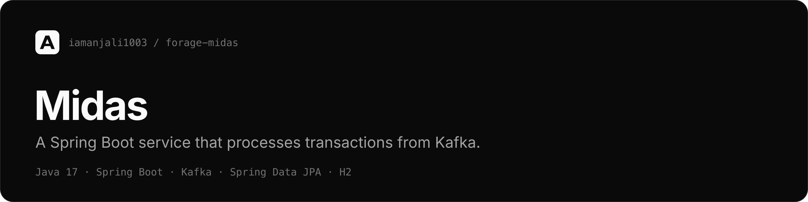

A Spring Boot service that reads transactions from Kafka, validates them, and keeps user balances in a database.

[Task write-ups](https://github.com/iamanjali1003/forage-jpmc-virtual-experience)

## Overview

Built during JPMorgan Chase's Software Engineering job simulation on Forage.
Forage provides the starting project, the tests for each task and the incentive
API. The five tasks, one commit each, are the work in this repository:

| Task | What it added |
| --- | --- |
| 1 | Project dependencies and Kafka configuration |
| 2 | A Kafka consumer for transaction messages |
| 3 | H2 persistence and transaction validation |
| 4 | A call to the incentive API on every valid transaction |
| 5 | A REST endpoint that returns a user's balance |

## Tech stack

| Area | Choice |
| --- | --- |
| Language | Java 17 |
| Framework | Spring Boot 3.2 |
| Messaging | Apache Kafka (embedded broker in tests) |
| Persistence | Spring Data JPA, H2 in-memory database |
| HTTP | Spring Web, `RestTemplate` |
| Build | Maven (wrapper included) |

## How it works

```
  Kafka topic "trader-updates"
        │   { senderId, recipientId, amount }
        v
  TransactionListener          @KafkaListener
        │
        v
  TransactionService           @Transactional
        1. load sender and recipient            ──> H2 (UserRepository)
        2. reject if either is missing, or the sender can't cover the amount
        3. ask for an incentive                 ──> Incentive API, POST :8080/incentive
        4. sender loses the amount; recipient gains the amount plus the incentive
        5. save both users and a TransactionRecord

  GET /balance?userId=1  ──>  BalanceController  ──>  H2
```

The whole update runs in one transaction, so a failure part-way leaves no
balance half-changed. If the incentive API can't be reached, the transfer still
goes through with an incentive of zero.

| Method | Path | Returns |
| --- | --- | --- |
| `GET` | `/balance?userId=<id>` | `{ "amount": <balance> }`, or `0` for an unknown user |

## Getting started

Needs JDK 17. The Maven wrapper downloads everything else.

```bash
./mvnw test                          # all five task suites, with an embedded Kafka broker
./mvnw test -Dtest=TaskFiveTests     # one task
```

To run the service on its own, start a Kafka broker on `localhost:9092` and the
incentive API, then the app:

```bash
java -jar services/transaction-incentive-api.jar   # port 8080
./mvnw spring-boot:run                             # port 33400
```

## Project structure

```
src/main/java/com/jpmc/midascore/
├── component/
│   ├── TransactionListener.java    Kafka consumer
│   └── DatabaseConduit.java
├── config/                         Kafka and RestTemplate setup
├── controller/
│   └── BalanceController.java      GET /balance
├── entity/                         UserRecord, TransactionRecord (JPA)
├── foundation/                     Transaction, Incentive, Balance
├── repository/                     Spring Data repositories
└── service/
    ├── TransactionService.java     validation and balance updates
    └── IncentiveService.java       calls the incentive API
```

## Credits

The starting project, task tests and incentive API come from JPMorgan Chase's
Software Engineering job simulation on [Forage](https://www.theforage.com/).
Tasks built by [Anjali](https://iamanjali1003.github.io).
